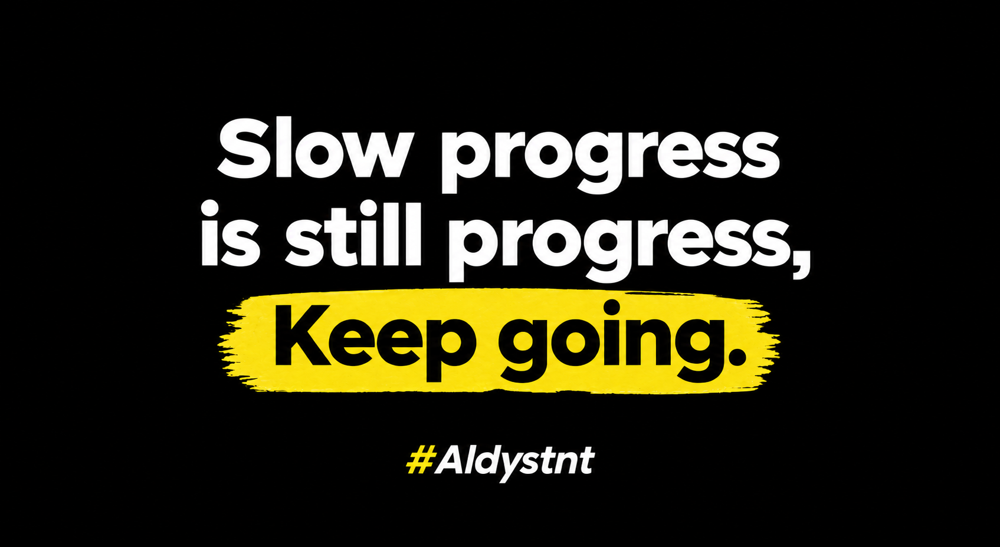

<h3>Hello 👋 I'm Aldi Sutanto</h3>

---

## 💫 About Me

🌟 Started my journey in web development with **PHP**

🌱 Currently learning the **Laravel Framework**

🔭 Building small projects to sharpen my skills

💬 Ask me about **PHP, Laravel, HTML, CSS and JavaScript**

👯 Open to collaborating on web projects

⚡ I love learning something new every single day

---

### 🌟 Follow Me On

<!-- Replace with your own links, then remove the comment markers -->
<!--  -->
<!--  -->
<!--  -->

---

### 🧰 Languages & Tools I Have Placed My Hands On

---

### ⚡ GitHub Stats

---

### 💻 Tech Stack

---

### 🎯 Learning Goals

- [x] PHP basics
- [ ] Laravel (routing, controllers, Blade)
- [ ] Eloquent ORM & database migrations
- [ ] Authentication & full CRUD
- [ ] Deploy my first Laravel project

---

### 💡 Motivation

---

*⭐ Thanks for stopping by my profile!*

